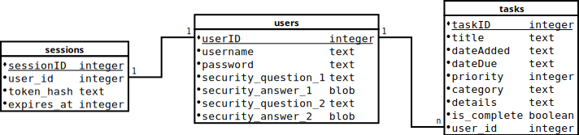

**Which tech stack/backend/database you chose and why?**

The original plan was to use the C++, Qt, and SQLite tech stack for this project.
However, due to time constraints, I decided to pivot to using Python, PyQt6, and SQLite instead.

While not the best in UI/UX, the tech stack allows for rapid development due to its great writability. 

**Python** excels with its huge amount of available libraries for use to integrate features in the code. 

**SQLite** is an easy way to store data in a local database and is able to integrate SQL statements in the Python code.

**PyQt** is a great library for creating GUI applications, but it has a steep learning curve and requires more time to learn.

Overall, the tech stack is excellent in developing simple applications, like a to-do app.

**How to run the app locally (setup steps, dependencies, commands)**

To run locally, execute the following commands in the terminal:
```bash
# clone the repository
git clone

# change directory to the project folder
cd cmsc128-lab1_CRUD_Medalla

# create a virtual environment

# for linux 
python3 -m venv .venv

# for windows
python -m venv .venv

# activate the virtual environment
# for linux
source .venv/bin/activate

# for windows
.venv\Scripts\activate

# install dependencies
# install pip if not installed
# for linux
python3 -m ensurepip --upgrade

# for windows
python -m ensurepip --upgrade

# if installed
python -m pip install --upgrade pip

# then run the following command to install dependencies
pip install -r requirements.txt

# run the app
./run
```

**Example "API endpoints" or data operations**

CRUD operations are handled by the `SQLiteConn` class in `api/sqlite3_api.py`.

- `open()` – Opens the database connection and creates the required tables.
- `close()` – Closes the database connection.
- `execute(query, params=None)` – Executes and commits a SQL query.
- `connection()` – Context manager that opens and closes the database connection.
- `add_task(title, date_added, date_due, priority, category, details, user_id, completion=False)` – Adds a task for a specific user.
- `remove_entry(taskID, user_id)` – Removes a user's task by ID.
- `update_entry(taskID, title=None, dateAdded=None, dateDue=None, priority=None, category=None, details=None, completion=None, user_id=None)` – Updates a user's task.
- `fetch_all_entries(user_id)` – Returns all tasks belonging to a user, or `None`.
- `fetch_entry_by_id(taskID, user_id)` – Returns a user's task by ID, or `None`.
- `get_tasks_for_user(user_id)` – Returns all tasks for a user, ordered by due date.
- `toggle_entry_completion(taskID, user_id)` – Toggles a task's completion status.
- `add_user(username, password, question_1, answer_1, question_2, answer_2)` – Creates a user account with hashed credentials and security answers.
- `authenticate_user(username, password)` – Verifies login credentials and returns the user ID, or `None`.
- `get_username_by_id(user_id)` – Returns a username by user ID, or `None`.
- `username_exists(username, exclude_user_id=None)` – Checks whether a username already exists.
- `reset_password(username, answer_1, answer_2, new_password)` – Resets a user's password after validating security answers.
- `create_session(user_id)` – Creates a session token and stores it securely.
- `compare_token(candidate_token)` – Validates a session token and returns the user ID, or `None`.
- `restore_session()` – Restores the current user's session, if valid.
- `logout()` – Deletes the current session and removes its stored token.

Methods that modify data in the database ensure that only the owner of the data can perform the operation by requiring the `user_id` parameter. If a user attempts to modify another user's data, the operation will fail.

**Session Storage**
The session works by storing a token in the database that is associated with the userID. When a user logs in, a new session is created and the token is stored in the database. Additionally, a token is stored in the operating system's keyring. When the user opens the app again, the session is restored by comparing the token stored in the database with the current session token stored in the operating system. If they match, the user is logged in automatically.

**Password Recovery Mechanism**
The password recovery mechanism works by asking the user to answer two security questions that they set up when they created their account. If the answers are correct, the new password that the user provided is set. 

**Screenshots of the working app**

The application is currently migrating to a new GUI framework (from tkinter to PyQt6). After the migration is complete, this section would be updated with screenshots of the working app.

**Activity 1 and 2 Merging strategy**

Since there has been a GUI framework overhaul from Activity 1 and Activity 2, there was no need to merge both activities together. Instead, a new implementation of the tasks was developed forward from the HEAD of Activity 2. Due to the merging strategy, there was no merge conflicts that were needed to be resolved. 

**Database Schema**
The database schema is defined in the `api/sqlite3_api.py` file. The schema consists of two tables: `users` and `tasks`. Their relationship is defined by the image below:


`tasks` table has a foreign key `user_id` that references the `usersID` column in the `users` table. This establishes a one-to-many relationship between users and tasks, where each user can have multiple tasks associated with them.

`sessions` table has a foreign key `user_id` that references the `userID` column in the `users` table. This establishes a one-to-one relationship between users and sessions, where each user can have only one session associated with them.

cmsc128-Indiv-Act1-finalX
cmsc128-Indiv-Act2-finalX